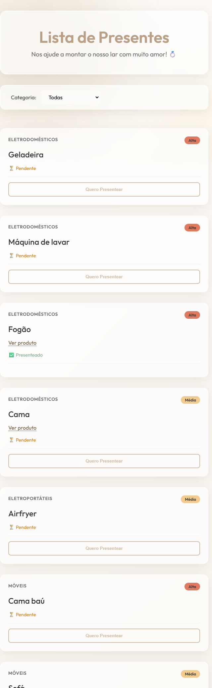
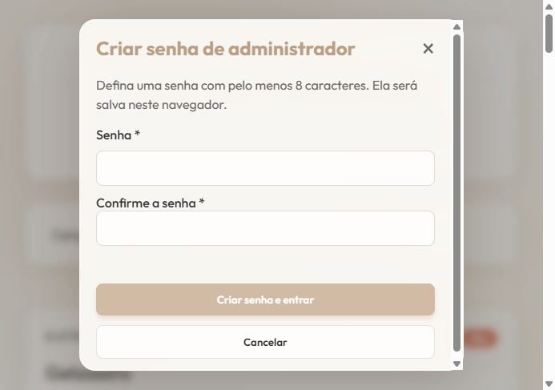

# Lista de Presentes

Uma página simples para compartilhar uma lista de presentes de casamento. Os convidados podem consultar os itens por categoria e informar quando pretendem presentear; a lista e as confirmações ficam salvas no navegador.

## Capturas de tela

### Lista de presentes



### Acesso administrador



## Como rodar

Não é necessário instalar dependências ou compilar o projeto. Na pasta do projeto, inicie um servidor HTTP local:

```powershell
python -m http.server 8000
```

Abra [http://localhost:8000](http://localhost:8000) no navegador. Também é possível abrir `index.html` diretamente, mas um servidor local oferece melhor compatibilidade com os recursos de segurança do navegador.

## Modo administrador

Abra `http://localhost:8000/?admin`. No primeiro acesso, crie uma senha com pelo menos oito caracteres; nos acessos seguintes, informe essa senha. No modo administrador é possível adicionar, editar e remover itens. Os convidados não veem esses controles.

**Importante:** este projeto é estático e não tem servidor de autenticação. A senha é armazenada como hash PBKDF2 no `localStorage` deste navegador e serve apenas como barreira visual; ela não protege os dados contra alguém que possa inspecionar ou modificar o navegador. A lista também é local a cada navegador e não é sincronizada entre dispositivos ou convidados. Para uso compartilhado com controle de acesso real, é necessário adicionar um backend.

## Funcionalidades

- Lista inicial de presentes com categoria e prioridade.
- Filtro por categoria.
- Formulários em modal para adicionar/editar itens e confirmar um presente com nome e mensagem opcional.
- Exibição do nome de quem escolheu o presente.
- Persistência local da lista usando `localStorage`.
- Modo administrador acessível por `?admin`.
- Validação de campos e links de produtos.

## Tecnologias

- HTML5
- CSS3 (layout responsivo e estilo glassmorphism)
- JavaScript (Vanilla)
- Web Storage API (`localStorage`)
- Web Crypto API (hash PBKDF2 da senha administrativa)